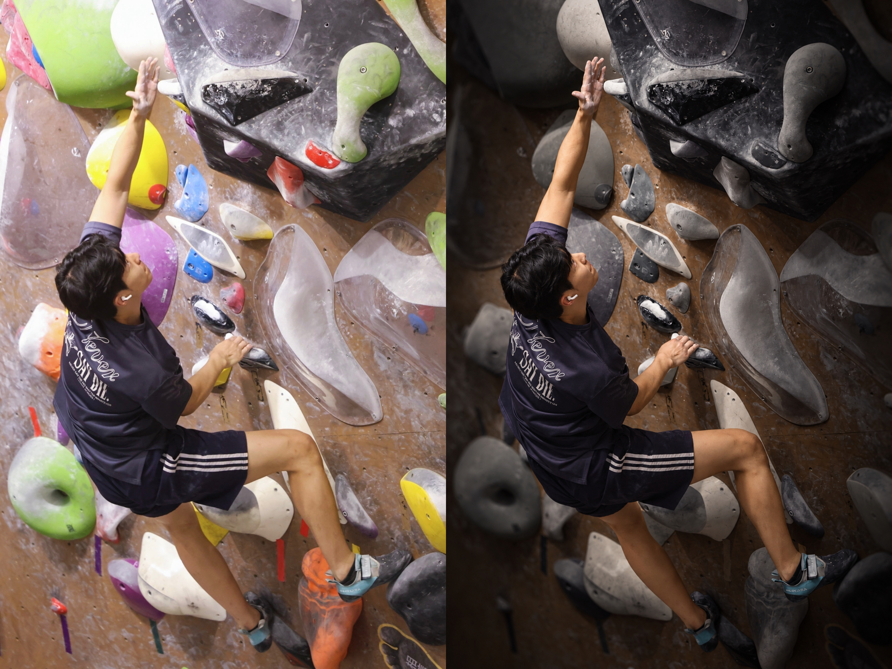

# 攀岩照片电影感 Skill

`climbing-photo-cinematic` 将攀岩/抱石照片处理成突出人物与目标线路的暗调运动摄影。核心是选择性保色、自然人物照明、外围压暗和适度景深虚化。

## 效果对比



**左：原图；右：处理后。** 这个示例保留黑线，将其他彩色岩点灰化；加强人物面部、手臂和腿部的受光，压暗并适度柔化外围环境，使人物和攀爬动作更突出。墙壁保持暖木色，衣物和肤色保留自然色彩。

## 使用方式

上传照片后，在 Codex 中写：

```text
使用 $climbing-photo-cinematic 处理这两张攀岩照片：
图1是蓝线，图2是粉线。人物更突出，保留墙壁色调。
```

没有给颜色也可以调用：

```text
使用 $climbing-photo-cinematic 优化这张攀岩照片，先和我确认线路颜色。
```

已明确颜色则直接处理；颜色缺失先询问并等待。相同颜色属于不同线路时，确认保留区域。例如“中间浅绿线保留，左侧另一条绿线灰化”。

## 处理内容

- 保留目标线路原有色相，将其他彩色岩点灰化或降饱和。
- 强化人物脸部、肩背、手臂、衣物和腿部的自然照明。
- 保持墙壁原有色调，外围逐渐变暗，暗部保留适量细节。
- 保持人物及手脚接触区域清晰，对前景人群、垫子和外围环境适度虚化。
- 尽量保留身份、动作、体型、装备、岩点布局和完整构图；逐图检查生成结果。
- 水印只在用户明确要求或当前任务已授权时移除，实际衣服/岩点标识和墙上告示保留。

这是图像编辑工作流，需要当前宿主提供 imagegen / image_gen 能力。默认使用内置工具，不依赖本仓库中的 API 密钥或脚本。生成式编辑可能造成细节变化，指令和检查并不保证逐像素一致。仅请求提示词时不生成图片。

## 文件结构

```text
README.md
.gitignore
docs/images/black-route-before-after.jpg
climbing-photo-cinematic/
  SKILL.md
  agents/openai.yaml
  references/prompt-template.md
```

仓库包含技能文本、配置及上方这张展示用对比图。对比图仅用于 README 展示，不作为技能运行时的必需输入；风格由文本定义，用户也可自行提供参考照片。

## 本地安装

把整个 `climbing-photo-cinematic` 文件夹放入宿主使用的用户技能目录，不能只复制 `SKILL.md`。

当前官方文档列出的用户目录是 `~/.agents/skills/`，项目目录是 `.agents/skills/`。某些现有 Codex 安装/skill-installer 工作流使用 `~/.codex/skills/`；应采用自己当前安装实际识别的目录，不在两个目录重复安装同名 skill。

Windows 上，若使用当前官方用户目录，从仓库根目录运行：

```powershell
$skillDestination = Join-Path $env:USERPROFILE '.agents/skills/climbing-photo-cinematic'
if (Test-Path -LiteralPath $skillDestination) { throw '技能已经存在，请先决定是否更新。' }
New-Item -ItemType Directory -Path (Split-Path -Parent $skillDestination) -Force | Out-Null
Copy-Item -LiteralPath './climbing-photo-cinematic' -Destination $skillDestination -Recurse
```

发布后，也可让 `$skill-installer` 从你的 GitHub 仓库安装 `climbing-photo-cinematic` 子目录。使用真实仓库链接，不是仓库首页的截图或 ZIP 文件名。

Codex 可检测技能变更；如果没有出现，重启 Codex 后再调用。目录与调用方式见 [OpenAI 官方技能文档](https://learn.chatgpt.com/docs/build-skills)。

## 上传 GitHub：网页操作

1. 解压交付的 ZIP，进入 `climbing-photo-cinematic-skill` 目录。
2. 登录 GitHub，打开 [创建仓库](https://github.com/new)，仓库名可用 `climbing-photo-cinematic-skill`。
3. 根据分享需求选择 Public 或 Private；已有本地 README，所以无需另生成 README 或 .gitignore。点击 **Create repository**。
4. 新空仓库页面点击 **uploading an existing file**；已有文件的仓库点击 **Add file → Upload files**。
5. 拖入解压目录里面的 `README.md`、`.gitignore`、整个 `docs` 文件夹及 `climbing-photo-cinematic` 文件夹，保留子目录层级。不要只上传 ZIP，也不要把外层 `climbing-photo-cinematic-skill` 再套进仓库。
6. 检查路径包含 `climbing-photo-cinematic/SKILL.md`、`climbing-photo-cinematic/references/prompt-template.md` 和 `docs/images/black-route-before-after.jpg`，这样 README 的对比图才能显示。
7. 写提交说明 `Add cinematic climbing photo skill`，按页面按钮提交。按钮可能显示 **Commit changes** 或 **Propose changes**；若选择新分支，后续通过 pull request 合并。

网页可以上传文件和文件夹，具体步骤见 [GitHub 上传文档](https://docs.github.com/en/repositories/working-with-files/managing-files/adding-a-file-to-a-repository)；创建仓库选项见 [GitHub 创建仓库文档](https://docs.github.com/en/repositories/creating-and-managing-repositories/creating-a-new-repository)。

## 上传 GitHub：可选命令行

先在 GitHub 建一个空仓库，不自动添加 README、.gitignore 或 license。进入本目录，依次执行下面命令；把仓库地址替换为你自己的真实地址。

```powershell
git init
git branch -M main
git add README.md .gitignore docs climbing-photo-cinematic
git commit -m "Add cinematic climbing photo skill"
git remote add origin https://github.com/YOUR-USERNAME/climbing-photo-cinematic-skill.git
git push -u origin main
```

如果 Git 要求配置提交身份，按提示配置你的名字和 GitHub 关联邮箱；如果推送要求登录，使用 Git 提供的登录流程。上述命令针对全新的本地目录和空远端仓库。更新已有仓库时使用其现有分支与 remote。

把 skill 存到 GitHub 是源码分享；它不会自动成为插件商店中的插件。若后续需要商店安装体验，可另行按 [官方插件打包文档](https://developers.openai.com/plugins/build/plugins) 包装。
